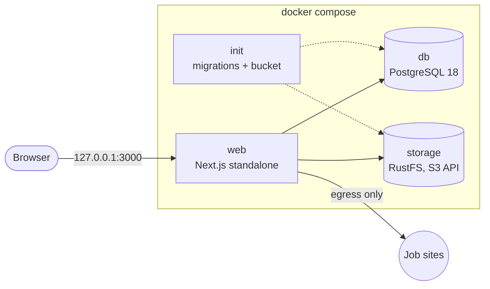

# Application Tracker

Track job applications during a job search in Switzerland: the offer, what I wrote in the
application form, the resume I sent, my contacts, and every status change until the outcome.

> Status: backend foundation. The UI is being designed and comes next.

## Features

- **Applications** with company, role, location, workload (e.g. 80–100%), salary ask (CHF),
  posting language, source, form answers and next action.
- **Status history**: every update is a dated event. The current status is the latest event,
  grouped as _Pending_, _On-going_ or _Closed_.
- **Resume library**: reuse a resume across applications or upload a new one. Other files
  (cover letters, screenshots…) attach to a single application.
- **Contacts** shared across applications.
- **Offer extraction**: paste a URL and the fields are prefilled. Supports jobs.ch, jobup.ch,
  LinkedIn and any site publishing a schema.org `JobPosting`, with a readable-text fallback.
  A plain-text snapshot is kept because postings disappear.

## Architecture



- **Next.js 16** (App Router, Server Actions, Cache Components), **TypeScript**, **Drizzle ORM**,
  **zod** validation.
- **PostgreSQL** for data; **S3-compatible object storage** for files ([RustFS](https://rustfs.com)
  locally, any S3 provider in production by changing env vars).
- Data lives only in named Docker volumes. The database and storage sit on an internal network
  with no internet access and no published ports.

### Code layout

```
src/lib/                    shared, client-safe: status model, enums, validation schemas
src/server/                 server-only (`import "server-only"`)
  env.ts                    the only reader of process.env, validated with zod
  db/                       Drizzle schema and client
  repositories/             queries, no business rules
  services/                 business rules, transactions, DTOs (no storage keys leak out)
  actions/                  Server Actions: the UI's entry points, typed ActionResult
  storage/s3.ts             object storage
  extraction/               offer extraction (SSRF-safe fetch, extractors, registry)
src/app/api/                files/[id] (download proxy), health
drizzle/                    SQL migrations
scripts/init.mts            migrations + bucket creation (one-shot container)
tests/unit, tests/integration
```

### Security notes

- No authentication yet (localhost only), but every entry point goes through the action and
  service layers, so adding it is one check plus an owner column.
- Files are never exposed from the bucket: `/api/files/[id]` streams them with `nosniff`, a
  sandboxing CSP and inline display only for PDF/images. Uploads are type-checked from their
  bytes, size-limited and stored under random keys.
- Offer extraction fetches arbitrary URLs, so it blocks private, loopback, link-local and
  metadata addresses at connect time (no DNS-rebinding window), follows redirects manually,
  and caps time and size.

## Getting started

Requirements: Docker, [uv](https://docs.astral.sh/uv/), Node 24 (`nvm use`), make.

```bash
make setup   # tooling + git hooks (pre-commit, Conventional Commits)
make env     # .env with generated secrets
make up      # build and start, then open http://127.0.0.1:3000
```

### Development

```bash
make dev                # db + storage in Docker, published on 127.0.0.1 only
npm run dev             # Next.js on the host, reads .env
make test               # unit tests
make test-integration   # services against real Postgres + storage (isolated test db/bucket)
make lint               # every pre-commit check on the whole repo
make db-generate        # new migration after a schema change
```

### Debug tools

```bash
make tools   # Adminer on 127.0.0.1:8080, storage console on 127.0.0.1:9001/rustfs/console/
```

Opt-in through a Compose profile and bound to loopback, so a plain `make up` exposes nothing
but the app.

### Backups

`make backup` writes a `pg_dump` and an archive of the stored files to `./backups/`
(gitignored).

## Contributing

Work happens on branches through pull requests: `main` is protected and requires the `lint` and
`conventional-commits` checks. Commit messages and PR titles follow
[Conventional Commits](https://www.conventionalcommits.org).

`make help` lists every command.
